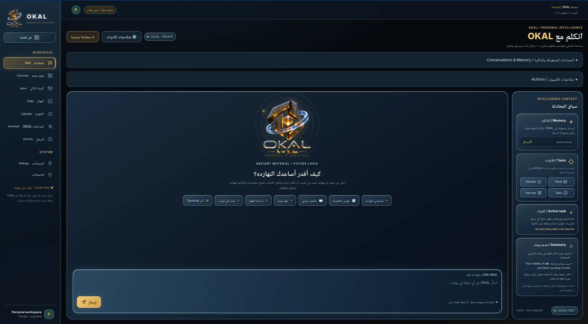

# OKAL — Local Personal AI Assistant

**Private, local-first AI chat with governed computer workflows, memory, Gmail,
Calendar and daily planning.** This is the active implementation repository,
not merely the older R1a inbox prototype.

OKAL runs one owner-controlled Python Core with a private SQLite state store,
local Ollama inference and a responsive Chat-first web interface. Model output
is not permission to act. User-granted capabilities, exact-action approvals,
verified receipts and recovery govern real computer operations. The historical
reset/pilot plan remains in [the Wiki](wiki/Personal-Assistant-Plan.md), but
later reviewed stages supersede its original feature deferrals.

## Desktop preview

*OKAL's Liquid Glass desktop interface (screenshot supplied by the owner, November 2026).
This is an interface preview, not a live service or model-usage status.*

## Current code scope

| Area | Merged capability | Boundary / outstanding acceptance |
| --- | --- | --- |
| Chat | Fullscreen bilingual conversation, saved history, resume and local-context responses | Local model availability and browser session required |
| Cognitive Memory V2 | Source-grounded cross-chat/project memories, correction/forget, local Mem0/Qdrant and optional Obsidian-compatible vault | **Production acceptance remains open in [#128](https://github.com/0PeterAdel/okal/issues/128)** |
| Computer | Scoped files/documents, desktop windows, local task/calendar adapters, bounded command profiles and verified execution receipts | Owner Actions grants; consequential actions require exact approvals |
| Storage diagnostic | Read-only connected block-device and mount-space receipts using Linux sysfs | Enable `system.status`; verify against actual owner host |
| Web | Read-only public HTTPS search and page reading with isolated Chromium and non-public network denial | Enable `browser.search` / `browser.public_read`; actual browser acceptance and external website behavior vary |
| Terminal | Explicit, owner-typed `/usr/bin` argv in a restricted no-network Bubblewrap sandbox | Enable `system.terminal`; always explicitly approve; **not an unrestricted host/root shell** |
| Daily | Gmail inbox/digest and reviewed actions, local appointments/goals, Calendar/Google Tasks read integrations and morning brief | Provider OAuth/sync freshness needs actual owner account checks |
| UI | Approved high-resolution OKAL logo, restrained Liquid Glass, spatial/HUD accents, Chat-first navigation and Actions panel | Browser/owner usability acceptance remains separate from code tests |
| Later | Social/freelance submission, mature voice and paired mobile workflows | Historic pilots and plans are not complete daily-product delivery |

**Repository merges are not deployments.** An owner-reported read-only
audit on November 7, 2026 observed `okal-core.service` active with HTTP
health 200, and live SQLite `chat_schema=2` passed integrity/foreign-key
checks, but the running production checkout was still at
`f7762b65eb12f580d054dcdb6dabe0e89c53cf17`. Later code on `main`
was **not** confirmed installed on that host at that time. This historical
audit is **not** a claim the service is running now. Do not migrate schema 2 again,
replace the live DB with an older snapshot, stop writes merely for a new
quiesced backup, or claim owner-device acceptance from GitHub CI.

## Start here

- [Cognitive Memory V2](docs/COGNITIVE-MEMORY.md), [Production readiness](docs/COGNITIVE-MEMORY-READINESS.md), [rollout and recovery](docs/COGNITIVE-MEMORY-ROLLOUT.md)
- [Intelligence Core](docs/INTELLIGENCE-CORE.md) and [Computer Actions](docs/COMPUTER-ACTIONS.md)
- [Owner-device Stage 3 release evidence](docs/STAGE3-RELEASE.md)
- [Storage diagnostics](docs/CHAT-SYSTEM-DIAGNOSTICS.md), [public web](docs/CHAT-PUBLIC-WEB.md), [terminal](docs/CHAT-OWNER-TERMINAL.md)
- [Gmail backend](docs/MAIL-BACKEND.md), [unified calendar](docs/UNIFIED-CALENDAR-ARCHITECTURE.md) and [morning brief](docs/LOCAL-CALENDAR-BRIEF.md)
- [Personal assistant plan (historical reset + later decisions)](wiki/Personal-Assistant-Plan.md)

## Run and permission boundaries

- Local AI through approved Ollama pins; no paid/cloud language-model fallback.
- A live internet connection and proper OAuth are required for online accounts
  and web search; cached provider summaries must disclose their freshness.
- Owner Chat and Actions are protected by the existing owner-browser boundary;
  read-device tokens **cannot** authorize computer actions or personal memory.
- The assistant cannot obtain tool grants, approve its own plans or fabricate
  results. Revoke individual tools/resources from Actions to remove authority.
- Browser discovery uses an ephemeral isolated profile and public-network rules,
  not your signed-in personal browser. Search queries leave the laptop.
- Terminal is explicit-owner-command, no network, no root and no broad/private
  home mount. A more powerful interactive host shell is a **separate**
  high-risk product/security design, not enabled by this repository update.
- The laptop cannot run background jobs while powered off. Unverified recovery
  and stalled provider sync must be surfaced rather than silently retried.
- No complete cold-boot, voice, remote phone or external publisher acceptance
  should be inferred from isolated feature CI.

## Governance, security and licensing

Changes use issue-linked feature branches, tested PRs, current-head CI,
reviewed scope/security and expected-head squash merges. Never push directly
to `main`. See [CONTRIBUTING](CONTRIBUTING.md),
[GOVERNANCE](GOVERNANCE.md), [AGENTS](AGENTS.md) and
[SECURITY](SECURITY.md). Do not commit owner SQLite, OAuth tokens, private
settings, historical raw prompts or local backups.

OKAL is MIT-licensed. Dependencies, models and provider services retain
their own terms; see
[Dependency Selection](wiki/Dependency-Selection-and-Licensing.md) and
[third-party notices](THIRD_PARTY_NOTICES.md).
