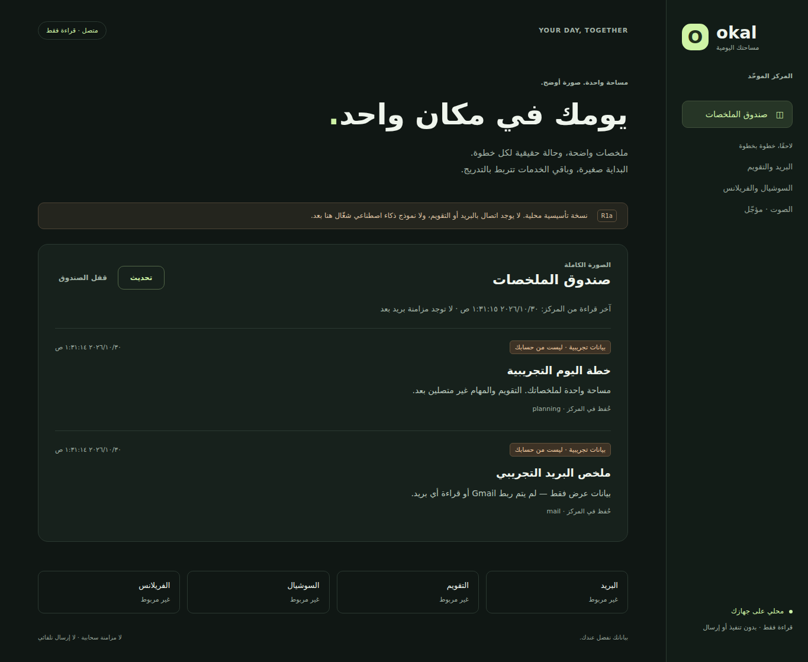

# Core inbox: R1a

Tracking: [#38](https://github.com/0PeterAdel/okal/issues/38), under
[#36](https://github.com/0PeterAdel/okal/issues/36). Experimental, read-only,
loopback-only foundation. This is not the full R1 release or a deployed assistant.

## What exists

- A separate `okal_core` package; the root voice package remains untouched.
- FastAPI, SQLite transactions, one responsive Arabic inbox and a local operator CLI.
- Expiring/revocable read-only tokens, stored as SHA-256 verifiers of random
  256-bit secrets, never plaintext. Tokens are issued locally, not over HTTP.
- Atomic run + summary persistence, exact-occurrence replay protection, bounded
  pagination and backup via SQLite's online backup API.
- A proposed systemd user unit and manual lifecycle instructions. Nothing is
  enabled automatically, and no old service is modified.

No Gmail/OAuth, model, schedule, account writes, shell executor, remote pairing,
TLS, offline browser cache, PWA installation, mobile push or native phone app.
The phone-width screenshot proves layout only, not a phone connection. Before
opening non-loopback access, implement pairing/TLS and re-review the boundary.

## Preview

These screenshots contain explicitly labeled fixtures, not real mail.



[Mobile-width screenshot](assets/core-inbox/core-inbox-mobile.png).

## Local trial

Use the reviewed feature branch containing this file. Check `git status` first;
do not reset/clean the existing checkout or remove old worktrees. Python 3.12-3.14
is the intended test range; do not install the root voice project for this trial.

Create an isolated environment only if `.venv-okal-core` does not already exist:

```bash
python3 -m venv .venv-okal-core
.venv-okal-core/bin/python -m pip install --require-hashes -r apps/core/requirements.lock
bash scripts/run-okal-core.sh init
bash scripts/run-okal-core.sh demo
bash scripts/run-okal-core.sh device-add desktop
bash scripts/run-okal-core.sh serve
```

Open `http://127.0.0.1:8766`. Paste only the generated `token` value into the
password field. Do not send that token, a screenshot of it, the SQLite database,
or backups to the PR/chat. No Gmail password is needed. Reloading or locking the
page clears the in-memory credential; the form is cleared immediately on submit.
No clipboard read permission or token URL is used.

The `demo` command is optional and idempotent. Omit it for an empty inbox.
The default state location is `$XDG_STATE_HOME/okal-core`, or
`~/.local/state/okal-core`. A different private directory can be selected before
the subcommand: `bash scripts/run-okal-core.sh --state-dir /absolute/private/path init`.
The directory must be owner-only (0700); the database must be 0600. Setup refuses
unsafe existing permissions or final-component symlinks rather than changing them.

List token metadata or revoke a specific device locally:

```bash
bash scripts/run-okal-core.sh devices
bash scripts/run-okal-core.sh device-revoke DEVICE_ID
```

Replace `DEVICE_ID` with an ID from `devices`. Tokens default to 30 days;
`device-add desktop --days 7` changes lifetime (1-90 days). All issued tokens
have the same single-owner `inbox:read` scope; this is not multi-account isolation.

## HTTP contract v1

| Method/path | Access | Result |
|---|---|---|
| `GET /api/v1/health` | Loopback, no token | `status: ok`, `schema_version: 1` only |
| `GET /api/v1/capabilities` | Bearer read token | Read-only mode; all integrations/execution disabled |
| `GET /api/v1/summaries?limit=20&cursor=...` | Bearer read token | Items, next cursor, fetched-at UTC epoch seconds |
| `GET /api/v1/runs/{id}` | Bearer read token | Redacted persisted result or 404 |

Authentication precedes private API validation/lookup. Bad/revoked/expired
credentials return 401, forbidden host/origin/client 403, invalid cursor 400,
invalid limit 422. Limit is 1-100. Cursor traversal freezes an ID upper bound so
new inserts do not repeat or skip existing records; refresh starts a new view.
The cursor is a read position, not an authorization token. Responses are no-store.

Each summary has `id`, `run_id`, `title`, `body`, `data_kind` (`fixture` or `live`),
`workflow` and `created_at` (UTC epoch seconds). The redacted run has `id`,
`workflow`, `status`, `created_at`, `summary_id` and `data_kind`. R1a stores only
completed `succeeded` runs, not active jobs or external-write receipts. Account
references, occurrence keys and content digests are internal. `fetched_at` is
the inbox read time, not a Gmail sync timestamp.

Only local Python producers may call `Store.record_success(SummaryInput(...))`.
Same workflow/account/occurrence and same content returns the existing run ID;
different content raises `Conflict`. Run and summary commit together or neither
does. This provides local persistence idempotency, not exactly-once external work.
There is no HTTP write/ingestion endpoint, provider URL execution or AI routing.

## Security and retention

The launcher binds only 127.0.0.1 and disables proxy headers/access logs. The API
also rejects non-loopback clients, foreign hosts/origins and cross-site browser
requests. No permissive CORS, CDN assets, analytics, OpenAPI browser UI or external
fonts. Untrusted title/body values are rendered with `textContent`, never HTML.

Same-user malware, privileged processes, browser extensions and physical device
access are outside this boundary. Localhost HTTP is not a phone transport; do not
reverse-proxy or port-forward it. No provider credentials belong in summaries.
SQLite is private on disk but not encrypted. Fixtures/summaries remain until an
explicit owner-approved data deletion; automated retention is not yet built.

## Optional login startup: owner test only

First pass the foreground trial. The unit assumes the stable checkout is
`~/Projects/okal` and uses `~/.local/state/okal-core`, regardless of a custom shell
XDG setting. Review paths before installing; don't point it at an archive.

The following installs only a new or identical unit; it refuses to overwrite a
different existing unit. Enabling is opt-in and changes only `okal-core.service`.

```bash
bash <<'BASH'
set -euo pipefail
okal_unit="$HOME/.config/systemd/user/okal-core.service"
if [[ -e "$okal_unit" || -L "$okal_unit" ]]; then
  if [[ -L "$okal_unit" ]] || ! cmp -s deploy/okal-core.service "$okal_unit"; then
    echo 'Existing core unit differs; review and back it up before replacement.' >&2
    exit 1
  fi
else
  install -Dm644 deploy/okal-core.service "$okal_unit"
fi
systemctl --user daemon-reload
systemctl --user enable --now okal-core.service
systemctl --user status okal-core.service --no-pager
BASH
```

No `sudo`, lingering, firewall, router, old voice or Voxtype change is required.
This targets login startup, not guaranteed boot-before-login. Lingering/encrypted
home support, laptop cold boot/logout/suspend and user-namespace compatibility
must be tested separately on Omarchy. Never silently remove hardening if a user
namespace restriction prevents startup; report the error and review the cause.

## Upgrade, backup, restore and removal

- Upgrade only from a reviewed branch/commit; stop this exact unit first and
  back up the database. Keep the previous checkout/lockfile for rollback. Do not
  overwrite a dirty checkout or auto-upgrade dependencies outside the lock.
- `bash scripts/run-okal-core.sh backup /absolute/private/backup.sqlite3` creates
  a new 0600 snapshot and refuses overwrite. Choose a private parent directory;
  the backup contains summaries and token verifiers. If the command fails, do
  not treat an incomplete destination file as a verified backup.
- Restore into a **new empty 0700 directory**, copy the snapshot as
  `core.sqlite3` preserving 0600, and run the CLI with `--state-dir` pointing there.
  Check the summaries and schema before changing a production unit. Never copy
  over a live DB or discard the current directory. A restored snapshot can
  revive tokens revoked after that snapshot: list and revoke old devices before
  serving, then issue fresh tokens. There are no external actions to replay.
- Stop automatic startup with `systemctl --user disable --now okal-core.service`.
  Removal of the unit/environment is optional separate maintenance; leaving them
  disabled preserves recovery. No uninstall command deletes personal state.

## Verification and exit gates

```bash
.venv-okal-core/bin/python -m pip install --require-hashes -r apps/core/requirements-test.lock
PYTHONPATH=apps/core/src .venv-okal-core/bin/python -m unittest discover -s apps/core/tests -v
PYTHONPATH=apps/core/src .venv-okal-core/bin/python apps/core/tools/verify_runtime.py
node --check apps/core/src/okal_core/static/app.js
bash -n scripts/run-okal-core.sh
systemd-analyze --user verify deploy/okal-core.service
```

The optional `tools/browser_smoke.py` uses Playwright 1.56.0 and disposable data.
It checks desktop/390px layout, no horizontal overflow or browser credential
storage, literal HTML rendering and clearing the screen after token revocation.
It is not a runtime dependency. CI runs unit/API/CLI tests and real process
restart on Python 3.12 and 3.14, plus shell/JavaScript checks.

Local evidence: 25 tests; browser smoke; graceful SIGTERM and persisted state after
restart; systemd static syntax verification. User-manager startup is **not**
verified in the cloud test host. See [runtime smoke](../apps/core/evidence/runtime-smoke.json)
and [dependency intake](CORE-DEPENDENCIES.md). Resource readings are peak RSS/CPU
for the fixture smoke, not an owner-device benchmark or isolated idle measurement.

Before R1 acceptance: owner foreground/restart/backup tests, actual service login
startup and suspend/recovery tests, dependency/security review, and a separate
reviewed TLS/pairing step for phone access. R2 Gmail comes after that foundation;
do not activate the old standalone Gmail scheduler alongside it.
